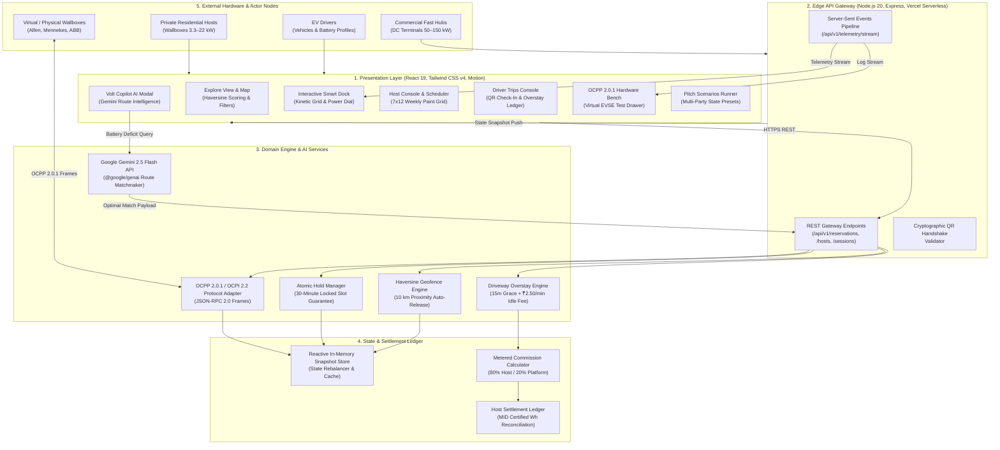

# Volt Garage (ImCharge) — Decentralized P2P EV Charging Marketplace

[](https://voltgarage.vercel.app/)
[](https://react.dev/)
[](https://www.typescriptlang.org/)
[](https://tailwindcss.com/)
[](#)
[](https://deepmind.google/technologies/gemini/)

* **Live Deployment:** [https://voltgarage.vercel.app/](https://voltgarage.vercel.app/)
* **Institution:** Mangalore Institute of Technology & Engineering (MITE), Department of Computer Science & Engineering
* **Team:** GoodCode
* **Event:** Visionet Techthon 2026 (Round 2)

---

## Overview

Volt Garage (ImCharge) is an electric vehicle charging marketplace and telemetry platform. The system connects private residential and commercial charging hosts with EV drivers, enabling homeowners to monetize idle driveway wallboxes while guaranteeing drivers reserved charging access.

The platform addresses two operational bottlenecks in urban EV adoption:
1. **Uncertainty of Public Stalls:** Public charging stations operate primarily on a first-come, first-served basis, resulting in queue congestion and idle arrivals. Volt Garage provides atomic 30-minute guaranteed holds enforced by a 10 km proximity geofence.
2. **Driveway Hogging:** Homeowners often hesitate to share residential chargers due to drivers overstaying after charging completes. Volt Garage incorporates an automated idle penalty engine (15-minute grace window followed by ₹2.50/min overstay billing) to ensure bays are vacated promptly.

---

## System Architecture

The following diagram illustrates the multi-tier event-driven architecture, spanning client interfaces, edge routing, protocol emulation, domain engines, and financial reconciliation.



---

## Core System Modules

### 1. Interactive Smart Dock (`InteractiveChargingDock.tsx`)
- **Kinetic Energy Grid:** Surface grid with cursor-reactive radial lighting and 3D perspective tilt (`rotateX`, `rotateY`).
- **Dynamic Power Band Selection:** Supports 3.3 kW (Eco AC, 16A/230V), 7.4 kW (Standard Wallbox, 32A/230V), 22 kW (Commercial Rapid, 32A/400V 3-phase), and 50 kW (DC Fast, 125A/400V).
- **Interlock & Telemetry:** Magnetic plug simulation with animated electron paths, live battery State of Charge (SoC) progression, and real-time active power/voltage telemetry.

### 2. Gemini AI Route Matchmaker (`GeminiVoltCopilotModal.tsx`)
- **Battery Curve Evaluation:** Evaluates vehicle capacity (e.g. 40.5 kWh for Tata Nexon EV, 78 kWh for Tesla Model 3), current battery percentage, destination, and target SoC.
- **Multi-Objective Scoring:** Evaluates station distance, power output, verified host rating, and scheduled availability. Generates an optimal reservation recommendation with an automated secondary fallback station.
- **Direct Hold Execution:** Converts dispatch recommendations directly into an atomic 30-minute hold with one click.

### 3. Driveway Overstay & Idle Fee Engine (`imchargeEngine.ts`)
- **Grace Period:** Provides a 15-minute free window once vehicle charging reaches 100% or terminates.
- **Automated Penalty:** Billed at ₹2.50 per minute of occupancy beyond the grace window.
- **Settlement:** Overstay fees are recorded on the session receipt, debited from the driver, and credited to host earnings to incentivize timely turnover.

### 4. OCPP 2.0.1 Virtual Hardware Test Bench (`OcppHardwareEmulatorDrawer.tsx`)
- **Protocol Emulation:** Simulates physical EVSE hardware controllers in software without requiring expensive test benches.
- **Signal Injection:** Supports `StatusNotification` (Available, Occupied, Maintenance), `MeterValues` (Wh energy accumulation, Voltage, Current, Board Temperature), and `WalkInLoadDetected`.
- **JSON-RPC 2.0 Log Terminal:** Displays live `CALL` (Tx) and `CONF` (Rx) protocol frames as they pass through the central system.

### 5. 30-Minute Atomic Hold & 10 km Geofence
- **Atomic Concurrency:** Eliminates slot collision by locking the target connector during the reservation window.
- **Continuous Distance Tracking:** Calculates distance using the Haversine formula. If the driver moves beyond 10 km of the reserved bay, the slot is automatically released to maintain network liquidity.

### 6. Host Availability Schedule Builder (`HostAvailabilityScheduler.tsx`)
- **Weekly Matrix:** 7-day by 12-slot visual calendar. Hosts paint available booking windows in 2-hour increments.
- **Reservation Guard:** The booking engine verifies host time slots before granting holds, preventing bookings outside preferred hours.

---

## Economic & Settlement Model

| Parameter | Private Residential Hosts | Commercial Fast Hubs |
| :--- | :--- | :--- |
| **Power Rating** | 3.3 kW – 22 kW AC | 50 kW – 150 kW DC |
| **Standard Pricing** | ₹18.00 / kWh | ₹26.50 / kWh |
| **Platform Commission** | **80% Host / 20% Volt Garage** | **15% Flat Transaction Fee** |
| **Reservation Hold** | 30-Minute Guaranteed Window | 30-Minute Guaranteed Window |
| **Driveway Overstay Fee** | ₹2.50 / min (after 15 min grace) | Station-specific idle tariff |
| **Disbursement Cadence** | Weekly automated IBAN transfer | Periodic B2B account settlement |

---

## Technology Stack

| Layer | Component | Purpose |
| :--- | :--- | :--- |
| **Frontend Framework** | React 19, TypeScript 7, Vite 8 | Single-page client architecture |
| **Styling & UI** | Tailwind CSS v4, Plus Jakarta Sans, JetBrains Mono | Component design system |
| **Animation & Micro-interactions** | Motion (Framer Motion v12) | State transitions and kinetic grid effects |
| **3D Rendering** | Three.js (r187) | CityMap3D navigation, SmartMeter3D, ChargerBay3D |
| **Artificial Intelligence** | Google Gemini 2.5 Flash (`@google/genai`) | Vehicle route optimization and battery matchmaking |
| **Backend API** | Node.js 20, Express 4 | REST routing and SSE stream dispatcher |
| **Protocols Supported** | OCPP 2.0.1, OCPI 2.2 | EVSE telemetry and roaming compatibility |
| **Deployment & CI/CD** | Vercel Edge Network, GitHub Actions | Continuous deployment and static asset delivery |

---

## Directory Structure

```text
├── ImCharge_Techthon2026_Round2_GoodCode.pptx   # 10-slide presentation deck
├── data/
│   └── imcharge-db.json          # Seed state for drivers, hosts, points, and sessions
├── src/
│   ├── api/
│   │   └── client.ts             # Gateway HTTP client and SSE event subscription
│   ├── components/
│   │   ├── InteractiveChargingDock.tsx   # Kinetic charging dock with power band dial
│   │   ├── GeminiVoltCopilotModal.tsx    # Gemini AI battery & route matchmaker
│   │   ├── OcppHardwareEmulatorDrawer.tsx# Virtual OCPP 2.0.1 hardware test bench
│   │   ├── JudgeScenarioSelector.tsx     # Demo pitch scenario runner
│   │   ├── HostAvailabilityScheduler.tsx # 7x12 weekly availability scheduler
│   │   ├── VoltGarageHero.tsx            # Hero section with dock and station previews
│   │   ├── ChargerBay3D.tsx              # Three.js charger bay technical view
│   │   ├── CityMap.tsx / CityMap3D.tsx   # 2D/3D city-scale navigation
│   │   ├── DriverTripsView.tsx           # Trip management, QR tokens & idle fee display
│   │   ├── HostConsoleView.tsx           # Host earnings dashboard & queue controls
│   │   ├── SmartMeter3D.tsx              # DIN-rail 3-phase MID smart meter twin
│   │   └── TelemetryStreamIndicator.tsx  # SSE connection health indicator
│   ├── domain/
│   │   ├── imchargeEngine.ts     # Haversine calculation, geofencing, billing & idle fee math
│   │   ├── imchargeEngine.test.ts# Domain unit test suite
│   │   └── types.ts              # Domain interfaces and type contracts
│   ├── server/
│   │   └── store.ts              # In-memory snapshot store with telemetry ingestion
│   ├── App.tsx                   # Main workspace layout, top header & routing
│   └── main.tsx                  # Client bootstrap entry point
├── server.ts                     # Express application server and SSE broadcaster
└── package.json                  # Dependencies and execution scripts
```

---

## Local Setup

### Prerequisites
* Node.js version 20.0.0 or higher
* npm, pnpm, or bun

### 1. Clone & Install
```bash
git clone https://github.com/Imafrah/Volt-Garage.git
cd Volt-Garage
npm install
```

### 2. Run Development Server
```bash
npm run dev
```
Open [http://localhost:5173](http://localhost:5173) in your browser.

### 3. Verification & Build
```bash
# Typecheck
npm run lint

# Compile production bundle
npm run build
```

---

## Team Ownership Matrix

**Institution:** Mangalore Institute of Technology & Engineering (MITE), Moodabidri  
**Department:** Computer Science & Engineering  
**Team Name:** GoodCode

| Member | Role | Technical Ownership |
| :--- | :--- | :--- |
| **Mohammed Afrah Usman** | Team Lead & Systems Architect | Full-Stack Architecture, OCPP 2.0.1 Telemetry & Edge Gateway |
| **Namita Naik** | AI & Domain Engine Engineer | Gemini AI Route Matchmaker, Geofencing Engine & Idle Fee Logic |
| **Meghna Poojari** | Frontend & Interactive UX Engineer | Interactive Kinetic UI, Host Schedule Builder & Driver/Host Consoles |

---

## License

This project is licensed under the MIT License.
