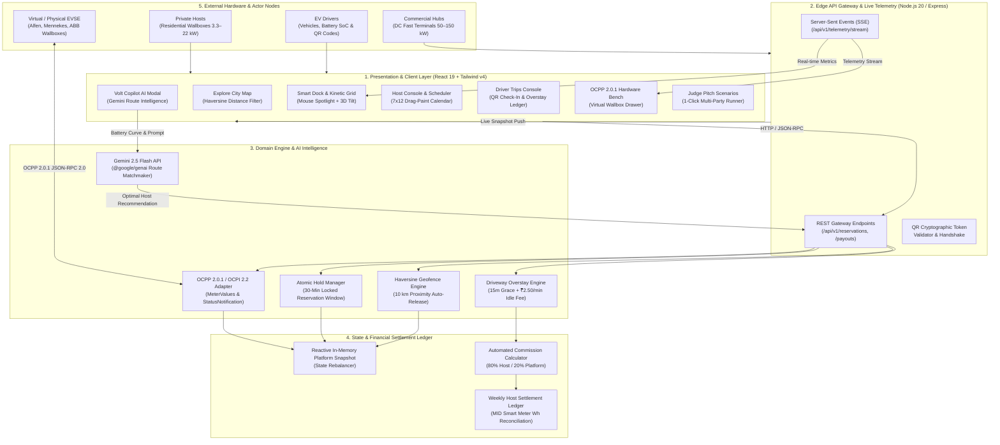

# Volt Garage (ImCharge) — Decentralized P2P EV Charging Marketplace

[](https://voltgarage.vercel.app/)
[](https://react.dev/)
[](https://www.typescriptlang.org/)
[](https://tailwindcss.com/)
[](#)
[](https://deepmind.google/technologies/gemini/)

> **Live Prototype:** [https://voltgarage.vercel.app/](https://voltgarage.vercel.app/)  
> **Techthon 2026 Round 2 Submission** | **Team:** GoodCode | **College:** Mangalore Institute of Technology & Engineering (MITE), Dept. of Computer Science & Engineering.

---

## ⚡ Executive Summary

**Volt Garage (ImCharge)** is a decentralized peer-to-peer (P2P) electric vehicle charging marketplace and digital twin ecosystem. It unlocks millions of idle residential and workplace wallboxes, converting private driveways into verified, income-generating charging hubs with **guaranteed 30-minute reservation holds**.

By integrating **Gemini AI route & battery matchmaking**, **automated driveway overstay penalties**, and an **OCPP 2.0.1 virtual hardware test bench**, Volt Garage solves the four core barriers to urban EV adoption: charging deserts, range anxiety, driveway hogging, and broken public charger queues.

---

## 🏛️ System Architecture Diagram



---

## 🌟 Key Innovations & Breakthrough Features

### 1. ⚡ Originkit-Inspired Interactive Smart Dock (`InteractiveChargingDock.tsx`)
- **Reactive Kinetic Grid & 3D Tilt:** Mouse-tracking radial spotlight and perspective tilt (`rotateX`, `rotateY`) reacting fluidly to cursor movement.
- **Dynamic Power Band Switcher:** Instant tactile toggle across **3.3 kW Eco**, **7.4 kW Wallbox**, **22 kW Rapid**, and **50 kW DC Fast**. Changing output dynamically shifts amperage (16A–125A), voltage, and electron flow particle speed.
- **Tactile Cable Interlock:** 1-click magnetic plug/unplug simulation with animated high-voltage electron conduits and live battery SoC visualizer.

### 2. ✨ Gemini AI "Volt Copilot" Matchmaker (`GeminiVoltCopilotModal.tsx`)
- **Battery Curve & Trip Analysis:** Driver inputs vehicle model (Tata Nexon EV Max, MG ZS EV, Tesla Model 3), starting SoC (e.g. 18%), destination, and desired battery.
- **Multi-Objective Optimization:** Evaluates power rating, dwell time, host schedule, and distance to produce an optimal charging stop with an automated backup station.
- **1-Click Slot Booking:** Converts AI dispatch reasoning directly into a guaranteed 30-minute hold.

### 3. ⏱️ Anti-Hogging Driveway Overstay Engine (`imchargeEngine.ts`)
- **The Challenge:** Homeowners hesitate to list chargers because drivers leave cars parked for hours after charging ends.
- **The Solution:** 15-minute free grace window upon charge completion.
- **Automated Penalty:** **₹2.50/minute idle fee** automatically begins accumulating, billed to driver and credited to host earnings.

### 4. 🔌 Virtual OCPP 2.0.1 Hardware Test Bench (`OcppHardwareEmulatorDrawer.tsx`)
- **Protocol Emulation:** Solves the physical hardware constraint by simulating EVSE controller signals in software.
- **Simulations:** Injects `StatusNotification` (Available, Plugged In, Fault), `MeterValues` (Wh accumulation, Voltage, Current, Board Temp), and `WalkInLoadDetected`.
- **Live Terminal:** Displays raw OCPP 2.0.1 JSON-RPC 2.0 `CALL` and `CONF` frames in real time.

### 5. 🔒 30-Minute Guaranteed Hold & 10 km Geofence
- **Atomic Slot Lock:** Prevents double-booking and eliminates queue uncertainty.
- **Active Proximity Geofencing:** If driver drifts beyond 10 km via Haversine calculation, the reservation is auto-released back to the network.

### 6. 📅 Drag-Paint Host Availability Scheduler (`HostAvailabilityScheduler.tsx`)
- **Visual Weekly Grid:** 7-day × 12-slot visual calendar. Hosts drag-paint exact hours when their private bay is open.
- **Schedule Enforcement:** System automatically rejects reservations outside the host's designated windows.

### 7. 🏆 1-Click "Judge Pitch Scenarios" Suite (`JudgeScenarioSelector.tsx`)
Built specifically for 3-minute hackathon stage pitches:
- **Scenario 1:** Core Workflow — Guaranteed 30-min hold + QR verification token.
- **Scenario 2:** Proximity Engine — Moves driver to Airport (~29 km), triggering automatic geofence release.
- **Scenario 3:** Host Protection — Renders a completed session with a ₹50 overstay fee.
- **Scenario 4:** Hardware Protocol — Injects a simulated OCPP walk-in load to demonstrate automated state reconciliation.

---

## 📊 Economic & Settlement Model

| Parameter | Private Residential Hosts | Commercial Fast Hubs |
| :--- | :--- | :--- |
| **Power Band** | 3.3 kW – 22 kW AC | 50 kW – 150 kW DC |
| **Typical Tariff** | ₹18.00 / kWh | ₹26.50 / kWh |
| **Platform Revenue Split** | **80% Host / 20% Volt Garage** | **15% Flat Commission** |
| **Hold Guarantee** | 30-Minute Atomic Hold | 30-Minute Atomic Hold |
| **Driveway Overstay Fee** | ₹2.50 / min (post 15m grace) | Dedicated Bay Tariff |
| **Payout Cadence** | Weekly automated IBAN transfer | Direct B2B reconciliation |

---

## 🛠️ Technology Stack

| Layer | Technologies |
| :--- | :--- |
| **Frontend Framework** | React 19, TypeScript 7, Vite 8 |
| **Styling & Design System** | Tailwind CSS v4, Plus Jakarta Sans, JetBrains Mono |
| **Motion & Micro-interactions** | Motion (Framer Motion v12), Originkit Kinetic Grid primitives |
| **3D Digital Twins** | Three.js (r187) — CityMap3D, SmartMeter3D, ChargerBay3D |
| **Generative AI** | Google Gemini 2.5 Flash (`@google/genai`) |
| **Backend API** | Node.js 20, Express 4, Server-Sent Events (SSE) |
| **Protocols Emulated** | OCPP 2.0.1 (JSON-RPC 2.0), OCPI 2.2 |
| **Deployment & CI/CD** | Vercel Edge Network, GitHub Actions CI |

---

## 📂 Project Directory Structure

```text
├── ImCharge_Techthon2026_Round2_GoodCode.pptx   # 10-Slide Round 2 Presentation Deck
├── data/
│   └── imcharge-db.json          # Seed state for drivers, hosts, points, and sessions
├── src/
│   ├── api/
│   │   └── client.ts             # REST client and SSE telemetry stream subscriber
│   ├── components/
│   │   ├── InteractiveChargingDock.tsx   # Originkit-inspired kinetic dock with power dial
│   │   ├── GeminiVoltCopilotModal.tsx    # Gemini AI battery & route matchmaker
│   │   ├── OcppHardwareEmulatorDrawer.tsx# Virtual OCPP 2.0.1 hardware test bench
│   │   ├── JudgeScenarioSelector.tsx     # 1-click live demo pitch scenario runner
│   │   ├── HostAvailabilityScheduler.tsx # 7-day x 12-slot weekly paint calendar
│   │   ├── VoltGarageHero.tsx            # Clean elevated hero showcase
│   │   ├── ChargerBay3D.tsx              # Three.js 3D charger bay exploded view
│   │   ├── CityMap.tsx / CityMap3D.tsx   # 2D/3D composite city navigation
│   │   ├── DriverTripsView.tsx           # Trips, QR tokens & overstay fee badges
│   │   ├── HostConsoleView.tsx           # Host earnings queue & MID meter twin
│   │   ├── SmartMeter3D.tsx              # DIN-rail 3-phase smart meter twin
│   │   └── TelemetryStreamIndicator.tsx  # SSE connection health monitor
│   ├── domain/
│   │   ├── imchargeEngine.ts     # Haversine, geofencing, metered billing & idle fee math
│   │   ├── imchargeEngine.test.ts# Automated unit test suite
│   │   └── types.ts              # Strongly-typed domain interfaces
│   ├── server/
│   │   └── store.ts              # In-memory store with OCPP event ingestion
│   ├── App.tsx                   # Main workspace layout, top header & navigation
│   └── main.tsx                  # Client DOM bootstrap
├── server.ts                     # Express server, SSE broadcaster & OCPP endpoints
└── package.json                  # Dependencies & scripts
```

---

## 🚀 Getting Started

### Prerequisites
* Node.js version 20.0.0 or higher
* npm, pnpm, or bun

### 1. Clone & Install
```bash
git clone https://github.com/Imafrah/Volt-Garage.git
cd Volt-Garage
npm install
```

### 2. Launch Local Dev Environment
```bash
npm run dev
```
Open [http://localhost:5173](http://localhost:5173) in your browser.

### 3. Verify Static Types & Build
```bash
# Typecheck
npm run lint

# Production bundle build
npm run build
```

---

## 👥 Team & Submission Information

* **Hackathon:** Visionet Techthon 2026 (Round 2)
* **Team Name:** GoodCode
* **Institution:** Mangalore Institute of Technology & Engineering (MITE)
* **Department:** Computer Science & Engineering
* **Team Representative:** Mohammed Afrah Usman
* **Live Deployment:** [voltgarage.vercel.app](https://voltgarage.vercel.app/)
* **Presentation Deck:** [ImCharge_Techthon2026_Round2_GoodCode.pptx](./ImCharge_Techthon2026_Round2_GoodCode.pptx)

---

## 📄 License
This project is licensed under the MIT License.
